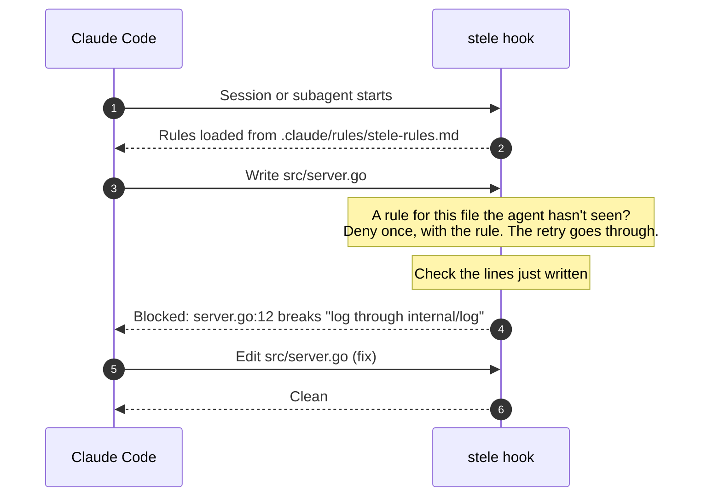

<div align="center">

<picture>
  <source media="(prefers-color-scheme: dark)" srcset="docs/assets/logo-dark.svg">
  
</picture>

# stele

**Make Claude Code and Codex follow your repository's rules.**

Write your rules once in `stele.md`. stele shows them to the agent before it writes,<br>
checks what it wrote, and checks again in CI.

[](https://github.com/lictor-ai/stele/actions/workflows/ci.yml)
[](https://github.com/lictor-ai/stele/releases)
[](go.mod)
[](LICENSE)

[Website](https://stele.lictorlabs.com) ·
[Quick start](#quick-start) ·
[How it works](#how-it-works) ·
[Does it work?](#does-it-work) ·
[Codex](#codex) ·
[Writing stele.md](#writing-stelemd) ·
[CI](#ci-stele-check) ·
[Shared rules](#shared-rules-from-another-repository) ·
[Plugins](#plugins) ·
[Limits](#limits)

</div>

---

## Why stele

Rules in `CLAUDE.md` or `AGENTS.md` are guidance: nothing checks them. In [our eval](#does-it-work), with the rules in `CLAUDE.md`, the agent broke one in 3 of 8 runs of a task that pulls against it. stele flagged each break right after the write, and the agent fixed it.

stele puts each rule in front of the agent when it matters, and catches what slips through:

- **Before a write**, the agent is shown the rules for the file it is about to write.
- **After a write**, the lines it just wrote are checked against rules that have a regex check.
- **In CI**, `stele check` checks the changed files.

And it stays out of your way:

- 📦 **One Go binary.** No daemon, no service, no config server.
- 🧠 **No model.** Rules are chosen by path and checked by regex: same input, same answer.
- 🔒 **No network calls of its own**, except `stele publish`, which you run yourself, and fetching [shared rules](#shared-rules-from-another-repository) you list in `stele.json`. [Plugins](#plugins) and [sinks](#send-the-log-somewhere-stele-push) you install may use the network.
- ⚡ **About 0.1 s per write.** See the [measured times](#does-it-work).

## Quick start

```sh
go install github.com/lictor-ai/stele/cmd/stele@latest   # install (or brew, scoop: see Install)
cd your-project && stele init                            # add the hooks and a starter stele.md
$EDITOR stele.md && stele compile                        # write your rules, compile them
```

Commit what `stele init` and `stele compile` wrote, start Claude Code, and the rules apply. For Codex, run `stele init --agent=codex` instead, and approve stele's hooks in Codex with `/hooks` (see [Codex](#codex)). Add [`stele check`](#ci-stele-check) to CI to catch the rest.

## How it works



Then, in the pull request, `stele check --base origin/main` checks every changed file against the same rules. Details: [What the agent sees](#what-the-agent-sees).

Codex works the same way, with the rules in `AGENTS.md` and `apply_patch` in place of Write and Edit: see [Codex](#codex).

## Does it work?

We gave Claude Code the same coding work with no rules, with the rules pasted into `CLAUDE.md`, and with stele. Then we counted how often the rules were respected.

| No rules | Rules in `CLAUDE.md` | stele |
|---|---|---|
| 33% | 63% | 100% |

We did the same with Codex, on the three hardest tasks (74 rules), with the rules in `AGENTS.md` instead of `CLAUDE.md`. 18 runs each, model `gpt-6-luna`:

| | No rules | Rules in `AGENTS.md` | stele |
|---|---|---|---|
| Rules respected | 6/18 | 12/18 | 18/18 |
| Tokens per run | 200k | 311k | 397k |

With Codex, stele cost 28% more tokens than `AGENTS.md`, mostly from one more turn per run. With Claude Code on the same tasks, stele and `CLAUDE.md` cost the same.

### Speed

The hook adds about 0.1 s per write on Windows. With 500 rules, it adds up to 0.17 s.

### See for yourself

Every experiment is in [test/functional/agent/results/](test/functional/agent/results/README.md), including the runs where stele lost.

## Install

macOS and Linux, with [Homebrew](https://brew.sh):

```sh
brew install lictor-ai/tap/stele
```

Windows, with [Scoop](https://scoop.sh):

```sh
scoop bucket add lictor-ai https://github.com/lictor-ai/scoop-bucket
scoop install stele
```

Or download the archive for your system from [Releases](https://github.com/lictor-ai/stele/releases) (`checksums.txt` lists their SHA-256) and put `stele` on your `PATH`. The binaries are not signed.

With Go 1.27 or later:

```sh
go install github.com/lictor-ai/stele/cmd/stele@latest
```

Or, from a clone: `go install ./cmd/stele`.

The hook runs the bare command `stele`, so it must be on the `PATH` that Claude Code or Codex sees: for `go install`, that is `$(go env GOPATH)/bin`.

## Set up a repository

Run `stele init` in the directory where you start Claude Code, normally the repository root:

```
$ stele init
stele init in /home/you/project
created .stele/.gitignore
created stele.md
added stele hooks (PreToolUse, PostToolUse, SessionStart, SubagentStart) to .claude/settings.json
wrote stele.lock
wrote .claude/rules/stele-rules.md
hooks: remind on, check on
```

- It works on the current directory only, and says so if a parent directory looks like the repository root (not when the current directory is a git worktree or submodule).
- It adds `stele hook --installed=<version>` to `.claude/settings.json` on `PreToolUse` (matcher `Write|Edit|MultiEdit|Bash`), `PostToolUse` (matcher `Write|Edit|MultiEdit`), `SessionStart` and `SubagentStart`, each with a timeout of 10 s. The rest of the file is kept. `<version>` is the release tag, or `devel` for a build from a commit (`go install ./cmd/stele` in a clone, or `@latest` before a tag); a build from a commit never replaces a release's stamp.
- It creates `stele.md` only if there is none. stele never writes `stele.md` or `stele.json` after that.
- It compiles the rules: `stele.lock`, and `.claude/rules/stele-rules.md`, which Claude Code loads at the start of every session and subagent, like `CLAUDE.md`. So the agent has the rules before its first write.
- Running it again prints `up to date, nothing written`. Every run ends with the state of the two write hooks.

### Turning the write hooks on and off

The two parts of the hook around a write can each be turned off:

| Flag | On (the default) | Off |
|---|---|---|
| `--remind` | Before a write, a write that needs rules the agent hasn't seen is denied, with the rules. | No write is denied to show rules. The agent still loads `.claude/rules/stele-rules.md` at session start. |
| `--check` | After a write, the lines written are checked, and a blocking violation is sent back as a block. | Nothing is checked after a write. An invalid rule in `stele.md` is still reported. |

```
$ stele init --remind=off
stele init in /home/you/project
updated stele hooks in .claude/settings.json
stele init: kept the existing stele.md
hooks: remind off, check on
```

A switch that is off is written on stele's hooks in `.claude/settings.json` (`stele hook --installed=<version> --remind=off`), so commit it and the team shares it. `stele init` without a flag keeps the switches as they are, so upgrading never turns a hook back on; `--remind=on` turns it on again. Either way, a write to stele's own files still asks you first, and `stele check` in CI is unchanged.

Then write your rules in `stele.md` and run `stele compile`:

```
$ stele compile
3 rules: 0 matched by text, 0 by position, 3 new, 0 dropped
wrote stele.lock, .stele/index.json and .claude/rules/stele-rules.md
```

**Commit** `stele.md`, `stele.lock`, `.claude/rules/stele-rules.md`, `.claude/settings.json`, and `stele.json` if you have one. **Don't commit** `.stele/`; it ignores itself. Don't edit `.claude/rules/stele-rules.md`: `stele compile` writes it from `stele.md`.

If a rule can't be used — a `check` other than `regex`, a pattern that doesn't compile or matches empty text, a `blocking` that isn't `true` or `false` — `stele compile` names it and exits 1. It still writes `stele.lock`, so the rule keeps its id, and the hook enforces the other rules and tells you once a session.

The hook also recompiles when `stele.md` changes, so edits take effect on the next write, except removing every rule, which takes `stele compile` (see [Limits](#limits)). Commit the updated `stele.lock` and `.claude/rules/stele-rules.md`. A session keeps the rules file it loaded at its start: a rule changed since is shown again before the next write it applies to.

To remove stele: `stele uninstall`. It removes stele's hooks, `.claude/rules/stele-rules.md` and `.stele/` (its [log](#what-stele-records) too), and keeps `stele.md`, `stele.lock` and `stele.json`.

### Codex

stele works with OpenAI's [Codex CLI](https://github.com/openai/codex) too, version 0.141 or later (0.145 or later on Windows). Run `stele init --agent=codex` where you start Codex:

```
$ stele init --agent=codex
stele init in /home/you/project
created .stele/.gitignore
added stele hooks (PreToolUse, PostToolUse, SessionStart) to .codex/hooks.json
wrote stele.lock
wrote AGENTS.md
stele init: Codex runs a project's hooks only in a trusted project, and only once you approve each one: start codex here, trust the project, type /hooks and approve stele's hooks. Until then Codex skips them, without a word in codex exec. Codex asks again whenever stele init changes them (--remind, --check).
stele init: kept the existing stele.md
Codex hooks: remind on, check on
```

- It adds `stele hook --agent=codex` to `.codex/hooks.json` on `PreToolUse` (matcher `^(apply_patch|Bash)$`), `PostToolUse` (matcher `^(apply_patch|Bash)$`, for `apply_patch` run through the shell, which Codex applies itself) and `SessionStart`, after any hooks already there. The command carries no version, so upgrading stele doesn't make Codex ask you to approve the hooks again.
- **Approve the hooks.** Start `codex` in the project, trust it, type `/hooks` and approve stele's three hooks. Codex runs no hook you haven't approved, and `codex exec` skips one without saying so. Turning `--remind` or `--check` on or off changes the hooks, so approve them again after.
- The rules go in `AGENTS.md`, which Codex loads at the start of every session, between a `<!-- stele:begin … -->` and a `<!-- stele:end -->` line. stele writes only between those lines and keeps the rest of the file as it is; with no such lines, it adds them at the end. Don't edit inside them: `stele compile` writes them from `stele.md`.
- `stele init --agent=claude-code,codex` sets up both. Without `--agent`, `stele init` and `stele uninstall` work for the agents already set up in the directory, or Claude Code when none is.
- `stele uninstall --agent=codex` removes stele's hooks from `.codex/hooks.json`, leaving its group empty while yours follow it so they keep their approvals, and its lines from `AGENTS.md`, and the file if nothing else is left; `.stele/` goes with the last agent's hooks.

Everything else is as for Claude Code: the same `stele.md`, the same deny before a write and check after it, the same switches, and `stele check` in CI. `stele stats` shows the two agents apart.

## Writing stele.md

Rules are separated by a line holding only `---`. A rule may start with `key: value` lines; then a blank line, then the rule in plain prose. HTML comments are skipped.

```markdown
scope: ["**/*.go"]
check: regex
pattern: fmt\.Print(f|ln)?\(
message: log through internal/log, not fmt.Print

Log through the shared logger in internal/log. Never print with fmt.Print,
Printf or Println.

---

scope: migrations/

Never edit a migration that has been merged. Add a new one instead.

---

check: regex
pattern: AKIA[0-9A-Z]{16}

Never put credentials in code, config or tests. Read them from the environment.
```

- Rule 1 is shown before writes to Go files, and checked.
- Rule 2 has no `check`: it is guidance, shown before writes under `migrations/`.
- Rule 3 has no `scope`: it is shown and checked for every file.

| Key | Meaning |
|---|---|
| `scope` | Path globs: `["a", "b"]` or one bare value. No scope means every file. |
| `check` | `regex`, the only checker. Any other value is an invalid rule. |
| `pattern` | A Go (RE2) regular expression, for `check: regex`, taken as written: quotes are part of it, so `pattern: "net/http"` matches `"net/http"` with its quotes, as in an import, not a bare mention of net/http. |
| `message` | What a violation says. Default: the start of the rule. Taken as written, quotes included. |
| `blocking` | `true` (the default with `check`) or `false`. |

Scope globs:

- `**` matches any number of directories: `**/*.go`.
- A pattern with no `/` matches the file name at any depth: `*.go`.
- A leading `/` anchors at the root: `/*.go`.
- A trailing `/` matches everything under a directory: `migrations/`.
- `{a,b}` matches either: `src/**/*.{go,ts}`.
- A leading `!` excludes: `["internal/**/*.go", "!**/*_test.go"]`. Order does not matter, and a scope of only exclusions means every other file. To match a file whose name starts with `!`, write `\!`.
- On Windows and macOS, matching ignores case.

## What the agent sees

This is what Claude Code sees. Codex sees the same, with the differences [Codex](#codex) and its [limits](#codex-1) list.

- **When a session or subagent starts.** Claude Code loads `.claude/rules/stele-rules.md`, every rule with its scope, as it loads `CLAUDE.md`. The agent is also told to create and change files with Write and Edit only, never through Bash: stele sees only those. It is told that reading, searching and running commands through Bash is fine.
- **Before a write**, unless `--remind=off`. A rule the agent loaded from `.claude/rules/stele-rules.md` at the start of its session counts as seen until the session ends, as long as the rule hasn't changed since; this needs Claude Code started in the project's root. The first write in a turn to a file with other rules is denied, with those rules as the reason. The agent reads them and retries. Each rule is shown once per turn, to the main agent and to each subagent; rules that do not fit in one message (about 9,000 bytes) are shown on the next write. A retry of the denied write goes through; parallel writes in the same message, to other files or to the same one, are denied too, once.
- **After a write**, unless `--check=off`. A blocking violation in the lines just written is sent back as a block, with file, line, rule and message. The write is not undone; the agent is told to fix it. Non-blocking violations are added as context.
- **A broken `stele.md`.** The last good rules keep applying, and the agent is told about the error.
- **A write to stele's own files** (`stele.md`, `stele.json`, `stele.lock`, `.claude/rules/stele-rules.md` or anything under `.stele/`, a subproject's too) asks you first, every time, whatever `stele.json` and the switches say. So does a write to Claude Code's settings files, which run stele's hooks: `.claude/settings.json` and `.claude/settings.local.json` anywhere in the project or from the session's directory up to the git root, and your user `settings.json`. A change there can weaken stele or turn it off. Allow it only if you asked for it.

## CI: stele check

| Command | Checks |
|---|---|
| `stele check` | Files changed against `HEAD`: staged, unstaged and untracked |
| `stele check --base <ref>` | Files changed since the merge base of `<ref>` and `HEAD` |
| `stele check --all` | Every tracked file |
| `stele check <path>...` | Exactly these files |

Add `--format json` for JSON. Deleted files are skipped.

`stele check` first checks the rules: `stele.md` must parse, every rule must be valid, and `stele.lock` and `.claude/rules/stele-rules.md` must be committed and current. After upgrading to a stele that writes the rules file, run `stele compile` and commit it, or `stele check` fails. The file is current when it holds the same rules in the same order; a newer stele's wording of its intro alone doesn't make it stale. A file at that path that stele didn't write (no `<!-- Generated by stele` first line) is left alone, and `stele check` fails until you rename it. A rules file over 40,000 characters gets a note: every session loads it whole. In a checkout with no `stele.md`, `stele.json` or `stele.lock` (a submodule, a worktree of a branch without rules, a repository that adds the CI job before its `stele.md`), it says `nothing to check` and exits 0; with `--base` it still reports a deleted `stele.md`. Then it checks the files:

```
$ stele check
main.go:6:2: error 573549ea-7f0b-47ec-ad30-db25284a3d2a "Log through the shared logger in internal/log. Never print w…": log through internal/log, not fmt.Print
main.go:7:10: error 2de7574e-7106-4986-8ce6-996d06e2703a "Never put credentials in code, config or tests. Read them fr…"
3 rules valid
checked 1 file: 2 errors
```

A non-blocking violation prints `warning` instead of `error`. Lines and columns start at 1; a column counts characters.

On your machine, `stele check` adds one line to the [log](#what-stele-records). In CI it writes nothing: it only logs where stele already has its key and `.stele/`.

**`--push`** then hands the run to every [sink](#send-the-log-somewhere-stele-push) `stele.json` lists. Where stele has its key and `.stele/`, as on your machine, it pushes the log's new lines, this run's included, as `stele push` does. With no key or no `.stele/`, as in CI, each sink gets one record of the run's counts: how many files and rules, errors and warnings, and how often each rule broke. Never the report: no file lines, no messages, no code. A sink missing from `PATH` fails before the check runs. The exit is the higher of the check's and the push's; with `--format json`, what `--push` says goes to stderr.

With `--base`, `stele check` also says when the branch adds, changes or deletes a `stele.md` or `stele.json` (`stele.md: modified on this branch: ...`), or moves a pin of [shared rules](#shared-rules-from-another-repository) in `stele.lock` (`stele.lock: modified on this branch: it pins the shared rules; review the change`), so reviewers see a change to the rules. It doesn't change the exit code; in JSON it is `rule_files_changed`.

| Exit | Meaning |
|---|---|
| 0 | Rules are valid (or there are none) and there is no blocking violation |
| 1 | A rule is invalid, `stele.lock` or `.claude/rules/stele-rules.md` is out of date (`stele.lock` also when `stele.json` lists a shared rules source it has no pin for), or there is a blocking violation |
| 2 | stele couldn't run: bad flags, no git, a git inside the project, unknown `--base` ref, no merge base, a bad `sources` in `stele.json`, a [shared rules](#shared-rules-from-another-repository) repository it can't read, a [plugin](#plugins) that is missing, refused, crashed, timed out or answered wrong, or with `--push` a sink that failed |

GitHub Actions:

```yaml
name: stele
on: pull_request
permissions:
  contents: read
jobs:
  stele:
    runs-on: ubuntu-latest
    steps:
      - uses: actions/checkout@v5
        with:
          fetch-depth: 0 # --base needs the history
      - uses: actions/setup-go@v6
        with:
          go-version: stable
      - run: go install github.com/lictor-ai/stele/cmd/stele@latest
      - run: stele check --base origin/${{ github.base_ref }}
```

Pin a version, such as `@v1.3.0`, instead of `@latest`. With [shared rules](#shared-rules-from-another-repository), the job also needs read access to the guidelines repository.

## stele.json

Optional, committed next to `stele.md`. This is the default:

```json
{ "block_on_error": false }
```

| Key | Effect |
|---|---|
| `sources` | Rules from another git repository, see [Shared rules](#shared-rules-from-another-repository), or from a program you install, see [Plugins](#plugins). |
| `checkers` | Programs you install that `stele check` runs for rules that name them: see [Checker plugins](#checker-plugins). |
| `sinks` | Programs you install that `stele push` sends the log to: see [stele push](#send-the-log-somewhere-stele-push). |
| `publish` | Where `stele publish` sends `stele.md`: see [stele publish](#publish-the-rules-stele-publish). |
| `$schema` | The schema's address, for your editor. stele ignores it. |
| `block_on_error` | What happens when stele itself fails (the signing key can't be read, `stele.json` invalid, `stele.md` never parsed). `false`: the write goes through and you get a warning. `true`: before a write, the write is blocked and the agent is told why; after a write, the agent is told it was saved but not checked. It applies only to a part of the hook that is on: with `--remind=off` or `--check=off`, that part's failures only warn. |

`backstop` is no longer read: use `stele init --remind=off`. `stele init` says so when `stele.json` still sets it, and leaves the file as it is:

```
$ stele init
stele init in /home/you/project
stele init: kept the existing stele.md
stele init: stele.json: backstop is no longer read; use stele init --remind=off
up to date, nothing written
hooks: remind on, check on
```

### Check stele.json in your editor

`schema/stele.v1.json` is the JSON Schema of `stele.json`. Point your file at it and your editor underlines mistakes as you type, suggests keys, and shows what each one does:

```json
{
  "$schema": "https://stele.lictorlabs.com/schema/stele.v1.json",
  "block_on_error": false
}
```

This works in VS Code, JetBrains IDEs and any editor that reads JSON Schema. The schema ships in this repository as `schema/stele.v1.json`; the website serves it at the address above from release v1.4.0 on. stele ignores `$schema` and never writes `stele.json`.

The schema is stricter than stele in a few places, on purpose. It flags a key stele doesn't know, such as `block_on_eror`, which stele skips without a word; a key in another case, such as `Name`, which stele reads anyway; and odd repository addresses, such as an empty port.

A few mistakes only stele sees: a plugin listed twice, a `timeout` outside 1s to 30m, and some repository addresses. stele reports those when a command reads the file, such as `stele compile` or `stele status`.

## Shared rules from another repository

Keep your guidelines in one repository and use them in all your projects. In each project, name that repository in `stele.json`:

```json
{
  "sources": [
    { "name": "git", "config": { "repo": "git@github.com:acme/guidelines.git", "ref": "main" } }
  ]
}
```

`stele compile` reads `stele.md` from it, adds its rules after the project's own, and pins the commit it read in `stele.lock`:

```
$ stele compile
github.com/acme/guidelines/stele.md: pinned main at 8611d48
3 rules: 0 matched by text, 0 by position, 1 new, 0 dropped, 2 supplied by their source
wrote stele.lock, .stele/index.json and .claude/rules/stele-rules.md
```

Commit `stele.lock` and `.claude/rules/stele-rules.md`: every developer and every CI run then uses the same commit. A new commit in the guidelines changes nothing until you move the pin on purpose:

```
$ stele compile
3 rules: 1 matched by text, 0 by position, 0 new, 0 dropped, 2 supplied by their source
up to date, nothing written

$ stele compile --update
github.com/acme/guidelines/stele.md: main 8611d48 -> 1dca9c3
4 rules: 1 matched by text, 0 by position, 0 new, 0 dropped, 3 supplied by their source
wrote stele.lock, .stele/index.json and .claude/rules/stele-rules.md
```

Review the `stele.lock` and rules file diff, then commit them. Changing `repo`, `ref` or `path` in `stele.json` pins again at the next `stele compile`. Until then `stele check` fails:

```
$ stele check
stele check: stele.lock is out of date with stele.json: run stele compile and commit stele.lock
```

| Key | Effect |
|---|---|
| `repo` | The repository: `https://host/path`, `ssh://host/path` or `user@host:path`, as for `stele publish`. |
| `ref` | A branch or tag. Default: the repository's default branch. A name that is both a branch and a tag needs `refs/heads/...` or `refs/tags/...`. |
| `path` | The rules file in it. Default `stele.md`. Letters, digits, `.`, `_`, `-` and `/`, ending in `.md`. |

- **Several sources add up.** List up to 16; their rules come after the project's, in the order listed. Nothing wins over anything: every rule applies.
- **Ids come from the guidelines.** When the guidelines repository has its own `stele.lock` next to its `stele.md`, its rules keep those ids in every project ("supplied by their source"). Run `stele compile` there and commit its `stele.lock`.
- **It uses your git login.** stele runs `git` on `PATH`, outside the project, and never asks for a password or holds a token: ssh keys and credential helpers work as they do for `git clone`.
- **It needs the network only for a new pin.** stele keeps a bare clone of each repository in your user cache directory (`stele/sources/` in it), never in the project. A commit it already has is read offline.
- **The hook never fetches.** It uses the rules from the last `stele compile`, `stele check` or `stele init` on your machine.

In CI, `stele check` reads the pinned commit, so the job needs read access to the guidelines repository. GitHub's default `GITHUB_TOKEN` reads only the repository the job runs in: give the job a deploy key for the guidelines repository, or a read token set in git's own config, never in `stele.json`. With no access, `stele check` exits 2:

```
$ stele check
stele check: source git:github.com/acme/guidelines/stele.md: git failed: git ls-remote: ERROR: Repository not found.
fatal: Could not read from remote repository.
Please make sure you have the correct access rights
and the repository exists.
stele needs read access to git@github.com:acme/guidelines.git: check that git ls-remote git@github.com:acme/guidelines.git works here
```

## Plugins

A plugin is a program you install that does what stele can't do itself: a source plugin gives it rules, a checker plugin checks code against them in `stele check`, and a sink receives the log from [`stele push`](#send-the-log-somewhere-stele-push).

### Source plugins

List a source plugin under `sources` in `stele.json`, by name:

```json
{
  "sources": [
    { "name": "paragraphs", "config": { "file": "GUIDELINES.txt" } }
  ]
}
```

stele runs `stele-source-paragraphs` from your `PATH` (`stele-source-paragraphs.exe` on Windows) and adds its rules after the project's own:

```
$ stele compile
3 rules: 0 matched by text, 0 by position, 3 new, 0 dropped
wrote stele.lock, .stele/index.json and .claude/rules/stele-rules.md
```

Commit `stele.lock` and `.claude/rules/stele-rules.md` as usual. `stele check` asks the plugin again, so when its rules change it fails until you run `stele compile`:

```
$ stele check
stele check: stele.lock is out of date with the rules: run stele compile and commit stele.lock
```

A plugin that isn't installed stops `stele compile`, `stele check` and `stele init` with exit 2:

```
$ stele compile
stele compile: source "paragraphs": stele-source-paragraphs not found on PATH: install it, or remove "paragraphs" from "sources" in stele.json
```

| Key | Effect |
|---|---|
| `name` | The plugin: stele runs `stele-source-<name>`. Lower-case letters, digits and `-`, starting with a letter. `stelemd`, `git` and `regex` are stele's own. |
| `config` | Passed to the plugin as it is. |
| `timeout` | How long a read may take: `"2m"`, from `1s` to `30m`. Default 1 minute. |

### Checker plugins

A rule's `check:` can name a checker plugin instead of `regex`. List it under `checkers` in `stele.json`; the rule's other keys are its settings:

```markdown
scope: ["**/*.go"]
check: word
word: TODO

Finish the work before you merge it: no TODO in Go code.
```

```json
{
  "checkers": [
    { "name": "word" }
  ]
}
```

`stele check` runs `stele-checker-word` on the files the rule's `scope` covers, here this `main.go`:

```go
package main

func main() {
	// TODO: read the config
}
```

```
$ stele check main.go
main.go:4:5: error 1bf07c03-cb51-4072-be43-2d2157d62b3f "Finish the work before you merge it: no TODO in Go code."
1 rule valid
checked 1 file: 1 error
```

The keys are those of a source plugin: `name`, `config` and `timeout`, where `timeout` is how long one check may take, 5 minutes by default. stele first asks the checker whether each rule's settings are right; a rule it rejects is invalid, as one `regex` can't compile is. A rule that names a checker `stele.json` doesn't list is invalid too. Every checker listed must be installed, even one no rule names yet.

A checker plugin runs only in `stele check`, never after a write: the hook and `stele compile` know it by name, and the agent learns of its violations from CI.

### Every plugin

- **Only from `PATH`, never from the project.** stele looks only in `PATH` entries that are absolute and outside the project and the git repository that holds it, so a copy inside the project is passed over, never run; on Windows the current directory isn't searched. One that links into the project is refused. On Windows it must be an `.exe` or `.com`.
- **Run with no shell, outside the project.** It runs in a directory of stele's own, `stele/plugins` in your user cache directory, and finds the project through the `root` stele sends it. It gets your environment, with `PATH` and the library and module paths (`LD_LIBRARY_PATH`, `PYTHONPATH`, `NODE_PATH` and the like) cut to entries outside the project. What it writes on stderr is shown, each line starting with its name.
- **What it starts stops with it.** After each call stele stops whatever the plugin left running. Ctrl-C stops the plugin too, and stele says the call was cancelled.
- **Never in the hook.** Source plugins run at `stele compile`, `stele check` and `stele init`, checker plugins at `stele check`, and sinks at `stele push` and `stele check --push`. `stele status` asks each listed plugin its version, unless you pass `--offline`. The hook uses the rules of the last compile, check or init on your machine.

Writing one takes a few lines in any language: [docs/plugin-protocol.md](docs/plugin-protocol.md) describes the protocol, with the `paragraphs` example above.

## What stele records

stele keeps a log of what it did in `.stele/log.jsonl`, one JSON line per event. Here is a write it checked, which broke a rule on line 3:

```
{"v":1,"kind":"checked","project":"150f0e27-e658-4514-a7c1-bd630412f323","ts":"2026-11-03T20:49:41.084298Z","session":"abc123","agent":"claude-code","file":"main.go","rules":["b7e248f0-fe55-4b23-89d0-6f0b9addf63d"],"violations":[{"rule":"b7e248f0-fe55-4b23-89d0-6f0b9addf63d","line":3,"blocking":true}],"more":0,"mac":"1d598cd1fdf7b37010c1750185898a5cb3f77561a9d69f49b6d6971cd1d73152"}
```

There are five kinds of line:

| `kind` | When |
|---|---|
| `loaded` | A session or subagent starts, with the rules it loaded from `.claude/rules/stele-rules.md` (`AGENTS.md` for Codex) |
| `denied` | A write or a Bash command is denied to show rules, with the rules shown |
| `wrote` | A write went through, with every rule that applies to the file |
| `checked` | A file is checked after a write, with what it broke, or nothing |
| `check` | `stele check` runs, with its counts |

A line holds rule ids, file paths, session and prompt ids, and counts. Never code, rule text or diffs. Each line is signed with your machine's key, so a line made on another machine, edited, or not written by stele is ignored. stele sends the log only to a sink you list, when you run [`stele push`](#send-the-log-somewhere-stele-push), and `stele uninstall` deletes it with `.stele/`.

## How the rules are doing: stele stats

`stele stats` reads the log and tells you which rules the agent breaks, whether it fixes them, and which rules never come up:

```
$ stele stats
last 30 days, 2026-10-04 to 2026-11-03 (+01:00), from .stele/log.jsonl
3 sessions, 36 turns with a write, 39 writes (39 checked), 3 denied (3 writes)

Broken most often (fixed: the agent's next write to the file, in the same turn, did not break it)
  4 writes, fixed 3 of 4  787f8bcc-82e6-4ab6-93d9-02860d4921ba "Never put credentials in code. Read them from the environmen…"

Dead: no write met a file they apply to, in 30 turns or more
  883fc015-b304-4f73-802c-b3df0f35516a "Migrations are append-only: never edit one that was merged." scope: migrations/**

Denied per day
  2026-11-03  3 (3 writes), 36 turns

stele check: 1 run, 0 found violations
```

What each part means:

- **A turn** is one message you sent in which the agent wrote something stele saw.
- **Broken** counts the writes that broke a rule. **Fixed** means the agent's next write to that file, in the same turn, didn't break it again.
- **Dead** rules are rules no write touched a file for. Their scope may be wrong, or the code they were for may be gone. A rule is judged only once 30 turns have passed since a session first loaded it. A rule `stele.lock` doesn't have yet is never judged.
- **Denied per day** counts the writes and Bash commands denied to show rules, by your local day.

With more than one agent in the log, a **By agent** part gives the same numbers for each.

**Too little data.** Under 30 turns, stats says so first and judges no rule:

```
Too little data to judge the rules: 6 turns with a write logged, stats need 30. The counts below are what happened, not a trend.
```

| Flag | |
|---|---|
| `--since 30d` | The window: `12h`, `30d`, `2w`, a day like `2026-10-01`, or `all`. Default `30d` |
| `--format json` | JSON, with `"v": 1` and the project id. It has every broken rule, and a fix rate once a rule has 10 broken writes |

`stele stats` exits 0, or 2 when it can't run. It reads the log, `stele.md` and, for [shared rules](#shared-rules-from-another-repository), the rules from your last `stele compile`; it writes nothing and makes no network call. Lines it can't use are counted at the end: lines not signed on this machine, lines from another project, lines in a newer format.

## What's installed: stele status

`stele status` tells you what stele has set up in a repository, and whether its rules are up to date:

```
$ stele status
stele devel in /home/you/project, project 0f1f82a6-f72c-4110-8133-1867a9f868b3

agents
  claude-code  hooks in .claude/settings.json (devel), remind on, check on, .claude/rules/stele-rules.md
  codex        not set up

plugins
  source   stelemd                        built in
  checker  regex                          built in
  checker  semgrep                        checker "semgrep": stele-checker-semgrep not found on PATH: install it, or remove "semgrep" from "checkers" in stele.json

sources
  stelemd                                1 rule, fresh

index: fresh
```

- **agents**: for each agent, whether stele's hooks are installed, the version they were installed by, the two switches, and whether the rules file holds stele's rules.
- **plugins**: the built-in ones, and each [plugin](#plugins) `stele.json` lists, with the version it reports or what is wrong with it.
- **sources**: how many rules each source has in the index, and whether it changed since the last `stele compile`. **index** is fresh when every source is.

| Flag | |
|---|---|
| `--format json` | The same as JSON, with `"v": 1` and the project id |
| `--offline` | Start no plugin: plugin versions, and whether a plugin source is fresh, show as unknown |

`stele status` writes nothing. To learn a plugin's version it runs the plugin, and it asks each plugin source whether it changed, unless you pass `--offline`. It exits 0 whenever it could describe the install, a missing plugin included, and 2 when it can't run (no project, or a `stele.json` it can't read). With a [sink](#send-the-log-somewhere-stele-push) listed, it also says how many log lines wait for it.

## The rules, for other tools: stele rules

The log and `stele push` name rules by id only. `stele rules` prints the rules behind those ids, the same ones the agent gets:

```
$ stele rules
cb820e6a-fe32-43db-8875-53bf87d20556  stele.md  every file
  Never build SQL by string concatenation. Use the query build…
911a21e4-63df-457f-9703-97e07347996e  stele.md  **/*.go, !**/*_test.go
  Return errors; never panic in library code.
2 rules
```

Each rule shows its id, where it comes from, its scope, and the start of its text. A [shared rule](#shared-rules-from-another-repository) shows its repository and file, then `@` and the first seven characters of the commit it was read at.

For a script or another tool, ask for JSON:

```
$ stele rules --format json
{
  "v": 1,
  "project": "caaac0e1-9ea5-4fb8-a2aa-d098d6acb015",
  "rules": [
    {
      "id": "cb820e6a-fe32-43db-8875-53bf87d20556",
      "source": {
        "name": "stelemd",
        "path": "stele.md"
      },
      "scope": [],
      "body": "Never build SQL by string concatenation. Use the query builder in db/."
    },
    {
      "id": "911a21e4-63df-457f-9703-97e07347996e",
      "source": {
        "name": "stelemd",
        "path": "stele.md"
      },
      "scope": [
        "**/*.go",
        "!**/*_test.go"
      ],
      "body": "Return errors; never panic in library code."
    }
  ],
  "notes": []
}
```

A shared rule's `source` also has `repo`, `ref` and `commit`. `notes` lists what is missing from the list, the same notes `stele rules` prints on stderr. For example, a fresh clone that has not run `stele compile` yet has no shared rules.

| Flag | |
|---|---|
| `--format json` | JSON, with `"v": 1` and the project id |

`stele rules` reads the rules the way the hook does: it updates the index when `stele.md` changed, starts no program and makes no network call. If `stele.md` has an error, it prints the last valid rules and says so. It exits 0 when it printed the rules, and 2 when it can't run.

## Send the log somewhere: stele push

The log stays on your machine. To send it somewhere, install a **sink**, a program named `stele-sink-<name>` on your `PATH`, and list it in `stele.json`:

```json
{ "sinks": [{ "name": "file", "config": { "path": "/home/you/stele-log.jsonl" } }] }
```

Then run `stele push`:

```
$ stele push
file: sent 4 lines
$ stele push
file: sent 0 lines
```

- **What a sink gets:** the lines of `.stele/log.jsonl`, exactly as stele wrote them, each with its signature. That is rule ids, file paths, session and prompt ids, and counts; never code. Lines not signed on this machine, or of another project, are skipped and counted. Each push also tells the sink where the project is on your machine (`project_dir`, for example `/home/you/project`), for its own use; that path can hold your user name.
- **The first push sends the whole log.** Listing the sink is how you agree to send it.
- **It remembers how far it got,** per sink, in `.stele/push/<name>.json`, signed. Each push sends only what is new, and finds its place after the log rotates.
- **A line can arrive twice,** if stele stops between the sink's answer and saving how far it got. Each record carries its `mac`, a key the sink can drop a repeat by.
- **A sink that fails stops for that run;** the others still get theirs. The next `stele push` tries again from where it stopped.

`stele push` exits 0 when every sink took everything (or there was nothing to send, or no sink), 1 when a sink took only part, and 2 when stele or a sink couldn't run: a sink missing from `PATH` (the others still get their lines), a crash, a bad answer, or another `stele push` running. stele runs a sink only from `stele push` and `stele check --push`, never from the hook. It opens no connection itself: where the lines go is the sink's doing. To write a sink, see [the plugin protocol](docs/plugin-protocol.md#push-sink).

`share_briefs` is accepted on a sink and does nothing yet: no line holds a brief.

## Publish the rules: stele publish

`stele publish` keeps a copy of the project's `stele.md` in a git repository you choose, as a merge request you review there. Name the repository in `stele.json`:

```json
{ "publish": { "repo": "git@github.com:you/guidelines.git", "path": "project-a/stele.md" } }
```

| Key | Effect |
|---|---|
| `repo` | The repository: `https://host/path`, `ssh://host/path` or `user@host:path`. No local path, no other transport, no password in the URL, and no user in an `https` URL: `stele.json` is committed, and a token there would be too. In the `user@host:path` form the path can't start with `/`: write `ssh://user@host/abs/path` instead. |
| `path` | Where `stele.md` goes in it. Default `stele.md`. Letters, digits, `.`, `_`, `-` and `/`, ending in `.md`. |

One repository per project needs only `repo`. Several projects can share one repository, each with its own `path`.

What it does:

- **It sends the committed `stele.md`**, as it is in the project's last commit. A `stele.md` with changes not yet committed is refused. It needs the project id in `stele.lock`: run `stele compile` first.
- **It commits it on the repository's default branch** and pushes that commit to the branch `stele/publish/<path>`. Running it again replaces that branch when `stele.md` changed or the default branch moved on; it never overwrites a commit on it that it did not make for this project.
- **It opens a merge request** into the default branch, or finds the one already open, on github.com and gitlab.com. It never merges. Run again with nothing new, it reopens a request that was closed.
- **It never asks for a token.** It uses a login you already have, in this order: the `gh` or `glab` login, git's stored credential (Git Credential Manager), then `GITHUB_TOKEN` or `GITLAB_TOKEN`. When none works, it prints the host's page to open the request yourself and tries to open it in the browser.
- **Nothing changes when the default branch already has this `stele.md`.**

Its working copy of the repository is a bare clone under your user cache directory (`stele/publish/` in it), never in the project.

A first publish, then the same `stele.md` again, then again after the pull request was closed, then after it was merged:

```
$ stele publish
pushed branch stele/publish/project-a/stele.md to https://github.com/nacer-noubir/stele-publish-test.git
merge request opened: https://github.com/nacer-noubir/stele-publish-test/pull/1

$ stele publish
branch stele/publish/project-a/stele.md in https://github.com/nacer-noubir/stele-publish-test.git already has this stele.md
merge request found: https://github.com/nacer-noubir/stele-publish-test/pull/1

$ stele publish
branch stele/publish/project-a/stele.md in https://github.com/nacer-noubir/stele-publish-test.git already has this stele.md
merge request reopened: https://github.com/nacer-noubir/stele-publish-test/pull/1

$ stele publish
project-a/stele.md on main in https://github.com/nacer-noubir/stele-publish-test.git is already this stele.md: nothing to publish
```

It exits 0 in all of these, and also when the branch is pushed but the merge request could not be opened. It exits 1 when it stops on an error, and pushes nothing:

```
$ stele publish
stele publish: stele.md has changes that are not committed; commit it first
```

```
$ stele publish
stele publish: bad publish setting in stele.json: repo "file:///srv/rules.git": only https and ssh are allowed; use https://host/path, ssh://host/path or user@host:path
```

```
$ stele publish
stele publish: branch stele/publish/project-a/stele.md in https://github.com/nacer-noubir/stele-publish-test.git holds commits stele publish did not make for this project; it is left alone
```

What leaves the machine: the committed `stele.md`, its `path`, the project's commit hash and id, and your git name and email, to `repo`; and, to github.com or gitlab.com only, the login it found.

## Limits

stele makes the rules hard to miss. It doesn't make them impossible to break. Know where it stops:

| | Limit | What covers it |
|---|---|---|
| 🚪 | A missing, crashed or timed-out hook lets writes through | `stele check` in CI |
| 🐚 | Bash, NotebookEdit and PowerShell writes aren't checked | `stele check` in CI |
| 🤷 | The agent can ignore the rules | Blocks after a write, then CI |
| 🔍 | A regex sees text, not code | Precise patterns, review |
| 📁 | Rules are chosen by path, not by task | Few unscoped rules |
| 🔑 | Codex runs only the hooks you approved | `/hooks` in Codex, then CI |

### Enforcement

**If `stele` is missing from `PATH`, or the hook crashes or times out, writes go through.** `block_on_error` only acts when stele runs and fails, so it can't prevent this.

**The agent can ignore the rules.** It is shown them and told about violations, but it can still choose not to follow them.

**With `--check=off`, only `stele check` finds violations.** With both `--remind=off` and `--check=off`, the agent still loads the rules at session start, but nothing enforces them until CI.

**Removing every rule takes `stele compile`.** A `git pull` can leave `stele.md` empty for a moment, so the hook never empties `stele.lock`. With no rules left in `stele.md`, or with `stele.md` gone and a `stele.json` beside it, the last rules stay in force until you run `stele compile`, and `stele check` fails until then. With `stele.md` gone and no `stele.json`, the hook does nothing at all.

**Only Write, Edit and MultiEdit are checked.** The agent is told at the start of each session to write files with those only. `stele check` in CI is the only catch for anything else.

<details>
<summary>What happens to writes through Bash</summary>

A Bash command that writes, by redirection, `tee`, `sed -i` or `perl -i`, into a file a scoped rule covers is stopped once per file each turn: the agent gets the rules and is told to use Write or Edit; run again, the command goes through unchecked. With `--remind=off` it is not stopped at all.

stele reads the command, it does not run it, so scripts, generators, `xargs`, `find -exec`, `$VAR` targets, brace expansion and writes into files only unscoped rules cover are not seen. A command stele can't parse is read up to the error, and what follows isn't seen: a real syntax error stops bash there too, so this only hides what follows a form stele doesn't know. `((` is read as arithmetic up to its `))`, so what nested subshells written that way write isn't seen, as in `((echo > a.go) && (echo > b.go))`; with no `))`, as in `((echo x > a.go) || true) && echo z > c.go`, nothing after it is seen either. `shopt` options aren't followed, so `shopt -s dotglob; rm bak/*` isn't seen removing dotfiles. A `cd` inside a function body written with `if`, `case`, `for` or `while` moves the directory stele tracks for what follows, though the function was only defined. A command's globs read at most 2,000 directory entries and take at most 5,000 steps, a step being a directory opened or a fixed path segment walked, those of the current directory included; a glob past either budget isn't expanded, and what it would match isn't seen. A command over 256 KiB isn't read at all, and past 64 targets the rest aren't seen. NotebookEdit and PowerShell are not hooked.

</details>

**Asking before a write to stele's own files covers Write, Edit and MultiEdit, and their names and links.**

<details>
<summary>What is and isn't asked about</summary>

A hard link to one of them, or an 8.3 short name, is caught only for the root's `stele.md`, `stele.json`, `stele.lock`, `.stele/` and `.claude` settings files. A Bash command that visibly writes, removes, moves or copies onto one of them is asked about too.

Not asked about: other Bash forms, removing or moving a directory that holds them, such as `rm -rf .claude` or `mv .claude x` (only `.stele/` is asked about by its own name), a NotebookEdit, managed settings, settings passed with `--settings` or the environment, and a session started above the stele project with hooks registered there by hand.

With no one to answer, as in `claude -p`, Claude Code refuses these writes, even ones you asked for.

</details>

### Checks

**A regex check only catches what a pattern can express.** It matches text, not code, so it also fires in comments and strings. RE2 has no lookaround or backreferences. The pattern runs over the whole file: use `(?m)` for `^` and `$` to mean line start and end.

**After an Edit, only the lines it wrote are checked.** If stele can't locate them (Claude Code sent no patch and the new text appears more than once), nothing is checked after that edit. Older violations in the file are left to `stele check`.

**Binary files and files over 32 MiB are skipped.** The skip is reported, not silent.

**Output is capped.** `stele check` shows at most 100 violations per rule and file; the agent gets at most 20 per message.

### Rules

**A rule with no `scope`, or only `!` exclusions, is shown for every other file.** Keep such rules few. Rules are chosen by path, not by task.

**Unknown keys are accepted silently.** A typo such as `scopes:` leaves the rule unscoped.

**stele skips a top-level key of `stele.json` it doesn't know, without a word.** A typo such as `block_on_eror` does nothing. [The schema](#check-stelejson-in-your-editor) flags it, but only in an editor that uses it.

### Shared rules

**A shared rule can't be switched off or changed in a project.** It applies as written, next to the project's own rules.

**Before the first `stele compile`, `stele check` or `stele init` on a machine, the hook knows only the project's own rules.** A fresh clone has no index yet, and the hook never fetches. The agent still loads the shared rules from the committed `.claude/rules/stele-rules.md`, but no write is denied or checked against them until then. `stele rules` lists only the project's own rules until then too, and says the shared ones are missing.

**A cloned project chooses where `stele compile`, `stele check` and `stele init` connect.** Its `stele.json` names the host, and ssh offers your keys to it, as `git clone` of a project with submodules would. Look at a `sources` entry before running stele in a project you don't trust.

**The guidelines repository writes what your agent reads.** A pin moved with `stele compile --update` brings in whatever its rules say: review the diff of `.claude/rules/stele-rules.md` before you commit it.

**A shared rule's `scope` matches paths in each project**, not in the guidelines repository.

**A pin moves only with `stele compile --update` or a change in `stele.json`.** A pinned commit must be on its ref: its tip or a commit before it. One that isn't, such as a commit only on another branch or a fork's pull request, is refused, and so is one a force push removed, once stele fetches the ref again: `stele check` then exits 2 until you run `stele compile --update`.

**After a pull that moves a pin, the hook doesn't enforce the new shared rules until you run `stele compile`.** It reads only the project's own rules: it keeps the shared rules your last `stele compile` read, and drops them once `stele.md` changes. It leaves the pulled `stele.lock` and `.claude/rules/stele-rules.md` as they are, so the agent still loads the new rules from that file at its next session.

**Windows limits paths to 260 characters.** stele's clone of a guidelines repository is in your user cache directory, under a 64-character name; a very long user cache path can make the fetch fail with "Filename too long".

### Plugins

**A plugin runs as you.** It can read your files, use your environment, tokens included, and reach the network. stele checks where it comes from, not what it does: install only plugins you trust. A plugin that changes into the project and starts programs by bare name can run what the project brought; that is the plugin's doing.

**On Windows, a process a plugin starts at once can outlive it.** stele puts the plugin in a job that stops everything in it, but a process it starts in the instant before it joins is not in the job.

**A cloned project chooses which plugins run.** Its `stele.json` names them, and stele runs the ones of those names on your `PATH`. It can't bring a plugin of its own, but it can make one you installed run with its `config`.

**Before the first `stele compile`, `stele check` or `stele init` on a machine, the hook knows only the project's own rules.** As for shared rules: the agent still loads a plugin's rules from the committed `.claude/rules/stele-rules.md`, but no write is denied or checked against them until then, and `stele rules` does not list them.

**A plugin's rules aren't pinned.** `stele check` asks the plugin again, so if it reads something outside the project that changed, `stele check` fails until you run `stele compile`.

**A teammate without the plugin can't compile or check.** A listed source plugin missing from `PATH` is exit 2 for `stele compile` and `stele check`, and a note at `stele init`; a listed checker plugin missing is exit 2 for `stele check`.

**A checker plugin never runs after a write.** Its rules are shown to the agent like any rule, but only `stele check` checks them, so the agent hears of their violations from CI, not right after it writes.

**`stele status` runs plugins.** It asks each listed plugin its version and each plugin source whether it changed, so a plugin runs as it would at `stele compile`. `stele status --offline` runs none.

### Projects

**A directory with its own `stele.md` or `stele.json` is a separate project.** Its files get only its rules. `stele check` at the parent skips it and says so; run `stele check` in it too.

**So is a git worktree or submodule** (a directory with its own `.git`). It gets no rules from an outer `stele.md`, only from its own. `stele check` there says nothing to check until it has its own `stele.md`, `stele.json` or `stele.lock`.

### Log

**A line can be lost, and nothing says so.** A line waits at most 100 ms for another writer, and a log stele can't write is skipped: the hook never waits or fails for it.

**Only writes the hook sees are recorded.** A Write or Edit that went through has a `wrote` line. A Bash command that writes has no `wrote` line, and one run again after its deny has no line at all. Nothing is recorded with stele's hooks off.

**`stele check` logs only where stele already runs.** With no key or no `.stele/`, as in CI, it records nothing.

**The log keeps about 64 MiB, up to 96 MiB on Windows.** Past 32 MiB it moves to `.stele/log.1.jsonl`, replacing the older one. On Windows the move fails while another program has the log open; lines are then still added up to 64 MiB, and dropped after that until the move works.

**Signing checks each line, not the log.** A line made on another machine, edited, or not written by stele is ignored. A line deleted, repeated, moved, or copied from another project's log on your machine isn't noticed.

**A dead rule may still be needed.** `stele stats` knows only the writes the hook saw, so a rule for files written only through Bash, by hand, or with the hooks off looks dead. It is judged only after 30 turns.

**"Fixed" is about the lines the agent wrote.** It means the agent's next write to the file in the same turn didn't break the rule. After an edit to other lines, the old violation can still be in the file; `stele check` reads the whole file.

**The thresholds are fixed.** 30 turns before a rule is judged dead, 10 broken writes before a fix rate. They can't be changed yet.

**A log you add to git leaves with it.** `.stele/` ignores itself, but `git add -f .stele/log.jsonl` commits the log like any file, and a push sends its file paths and session and prompt ids along.

**A sink can get a line twice.** Delivery is at least once: if stele stops between a sink's answer and saving how far it got, the next `stele push` sends those lines again. A sink drops a repeat by its `mac`.

**Lines can rotate out before they're pushed.** The log keeps one older file; a line that rotated out twice since the last `stele push` is never sent, and `stele push` says some lines were lost.

**An edited log stops the push to a sink.** If the last line a sink got is no longer in the log, or a log file is too large to read, `stele push` won't guess where to go on: that sink fails (exit 2) until you delete `.stele/push/<name>.json`, which sends the whole log again.

**A sink is your program.** stele checks where it comes from, as for any plugin, not what it does with the lines. A cloned project's `stele.json` can name a sink you installed, and `stele push` then sends that project's log to it.

**`share_briefs` does nothing yet.** No log line holds a brief.

**`stele check --push` sends nothing when the rules can't be used.** A parse error, a stale `stele.lock` or an out-of-date rules file fails the check before it runs, and nothing goes to a sink for that run.

### Codex

**Codex runs no hook you haven't approved, and `codex exec` skips it without a word.** stele can only say so at `stele init`. Changing `--remind` or `--check` changes the hooks, and Codex wants them approved again.

**Codex can't ask you about stele's own files.** A patch to `stele.md`, `stele.json`, `stele.lock`, `.stele/` or an agent's settings files is refused, and Codex is told to ask you to make the change.

**Codex's shell is read, not checked, and the reading is best effort.** On Windows it runs PowerShell, and stele reads its commands as PowerShell: redirections after any word, `Set-Content`, `Add-Content`, `Out-File`, `Tee-Object`, `New-Item` (links too), `Clear-Content`, `Copy-Item`, `Move-Item`, `Rename-Item`, `Remove-Item`, `Export-Csv`, `Export-Clixml`, `Start-Transcript` and `Invoke-WebRequest -OutFile` by any alias or module-qualified name, `[IO.File]`'s write, copy, move and delete methods and an `IO.StreamWriter` on a path, here-strings, array literals, and a `powershell`, `pwsh`, `bash` or `cmd /c` given a literal script. A command that writes a file a scoped rule covers is stopped once per file each turn, as a Bash one is. Not seen: scripts, `Invoke-Expression` and `Start-Process`, paths taken from the pipeline, variables set in a block or from a command, expressions or `$(...)` as paths, splatting, and any other cmdlet or .NET API. `stele check` in CI is the catch.

**Codex reads only the first 32 KiB of its `AGENTS.md` files.** If stele's section ends past that, counting the `AGENTS.md` files of the directories above, or if an `AGENTS.override.md` sits beside it, Codex starts without the rules, and the deny before a write shows them instead. A `-c project_doc_max_bytes=…` on the command line isn't seen.

**The rules count as loaded only at a session's startup, launched in the project or below it.** After a resume, a compaction, `/clear` or a fork, and in a subagent, the deny shows the rules again. So it does when a `.git` sits between the project and where Codex runs, as in a submodule, since Codex then starts its walk there, and when an `AGENTS.md` may have changed since the session started: Codex reads it when the session starts, and stele hears of the session only at its first prompt. stele counts a change from the files' times and those of their directories, which a removal or a rename changes, with a margin of 2 seconds, so a session started within 2 seconds of any change in the project's directory, or a directory above it up to the repository, shows the rules again too.

**Removing a hook can cost the approvals of the hooks after it in its group.** Codex keys an approval by place. Uninstall keeps stele's group, empty, so the groups after it keep theirs; a hook you added inside stele's own group, after its handler, moves up and must be approved again.

**`AGENTS.md` must be UTF-8.** A UTF-16 one is left alone, with a note, and Codex starts without the rules. When stele adds its section to a file whose last line has no line end, it adds one.

**Notes past about 6,000 bytes are cut.** Codex moves a hook's longer context into a file the model may not open, so stele cuts it, says so, and `stele check` shows the rest.

**Only `apply_patch` is checked,** whether Codex calls it as a tool or runs it in its shell. Writes through MCP tools aren't seen.

**Only the version is checked, at `stele init`.** stele runs `codex --version` there and never in the hook. The release notes, not stele, are the source for 0.141 and 0.145.

### Upgrades

**A stele from before shared rules refuses a `stele.lock` that pins one.** Such a lock is `"version": 2`. The older stele says to restore it or delete it: do neither, upgrade stele instead.

**The reminder to re-run `stele init` compares tagged releases only.** A build from a commit, or with local changes, stamps `devel` and is never warned about.

> [!WARNING]
> **A stele from before `--remind` and `--check` must not run `stele init` on hooks that carry a switch: upgrade it first.** It doesn't recognise the switches, so its `stele init` adds a second set of hooks, and it runs both hooks whatever the switches say. Every release so far, v1.0.0-dev.2 included, still tells you to run `stele init` when it meets hooks a newer release wrote. Only a stele with the switches tells you to upgrade instead.

### Network and publishing

**stele itself sends your project's content over the network only from `stele publish`, and only when you run it.** It sends the committed `stele.md`, its path, the project's commit hash and id, and your git name and email to the `repo` in `stele.json`, and a login to github.com or gitlab.com.

**The log goes only to a sink you list, when you run `stele push` or `stele check --push`.** stele hands the sink the lines and opens no connection itself; what the sink does with them, network included, is its own. A sink runs as you, like any [plugin](#plugins).

**Shared rules are fetched, never sent.** `stele compile`, `stele check` and `stele init` connect to each `repo` under `sources` when they need a commit they don't have. git sends what a fetch sends: the refs and commits it wants and has of that repository, and your login for that host through your own git setup. Nothing of the project goes with it. The hook and `stele stats` never connect. stele itself makes no other network call; a [plugin](#plugins) you install may. The rules and violations it hands the agent become part of the conversation, which Claude Code sends to the model as usual.

**`stele publish` opens merge requests on github.com and gitlab.com only.** Any other host, a self-hosted GitHub or GitLab included, gets the branch pushed and is told to open the request by hand, with no link.

**`stele publish` has not been run against gitlab.com.** It was run against github.com; its GitLab calls are tested only against a fake server.

**`stele publish` needs a repository with at least one commit, and git access to it.** git and Git Credential Manager are never allowed to prompt. ssh still can: a key's passphrase or an unknown host key is asked by ssh itself.

**`stele check`, `stele publish` and shared rules guard against programs a project brings with it, and only in these ways.**

- **Programs refused.** `stele check` and shared rules refuse a git, and `stele publish` a git, gh, glab or browser opener, found on `PATH` inside the project or inside the git repository that holds it, or through a relative `PATH` entry. That counts one that links to somewhere else, as a nix `result/bin` does. Links and junctions are followed, and directories compared by identity, so another spelling of the path counts too. `stele check` then exits 2; `stele check <paths>` needs no git.
- **`PATH` entries removed.** What they start doesn't get `PATH` entries that are empty, relative or inside those same directories. On Windows, a quoted entry goes whole if any `;`-separated part of it would.
- **git config overridden.** Every git command they run is given `core.fsmonitor=false` and `safe.bareRepository=explicit`, so git won't use a folder laid out as a bare repository unless told to: `stele check` in one exits 2. `stele publish` and shared rules also give `credential.interactive=never`, the `protocol` settings that allow only https and ssh, and `submodule.recurse=false`, `fetch.recurseSubmodules=false` and `push.recurseSubmodules=no`; shared rules add `transfer.fsckObjects=true`. `stele check` doesn't: a partial clone still fetches what it needs from where it was cloned.

Not covered:

- `safe.bareRepository` needs git 2.38 or later. An older git ignores it, and uses such a folder.
- Only the repository nearest to where the project's path leads counts, so a superproject's folder or a linked worktree's main checkout is not inside the project.
- A repository at your home directory or a filesystem root doesn't count: with `~/.git` or `/.git`, a program in `~/bin` or `/usr/bin` is not refused. The project's own folder still counts.
- A program named by an environment variable, such as `GIT_SSH_COMMAND` or `GIT_EXEC_PATH`, still runs, as does one named by any git config not listed above, such as `core.sshCommand`.

**`stele publish` refuses a `stele/publish/<path>` branch holding commits it did not make for this project.** Two projects that publish to the same `path` of one repository get that error; give each its own `path`.

## Learn more

- [docs/plugin-protocol.md](docs/plugin-protocol.md): how to write a source, checker or sink plugin.
- [docs/architecture.md](docs/architecture.md): how stele is built, its packages and contracts.
- [docs/adr/](docs/adr/): the decisions behind it. The newest: [the log](docs/adr/0010-a-local-log-of-what-stele-does.md), [shared rules](docs/adr/0011-rules-from-another-git-repository.md), [Codex](docs/adr/0012-a-second-agent-codex.md), [plugins](docs/adr/0013-external-plugins.md), [sinks, push and status](docs/adr/0014-sinks-push-and-status.md).
- [test/functional/](test/functional/): the black-box tests and the agent eval.

## License

[Apache 2.0](LICENSE).
